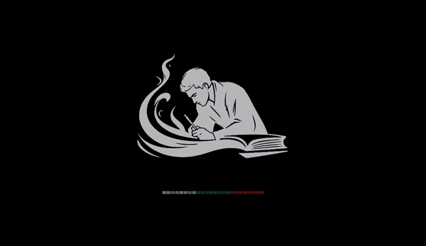
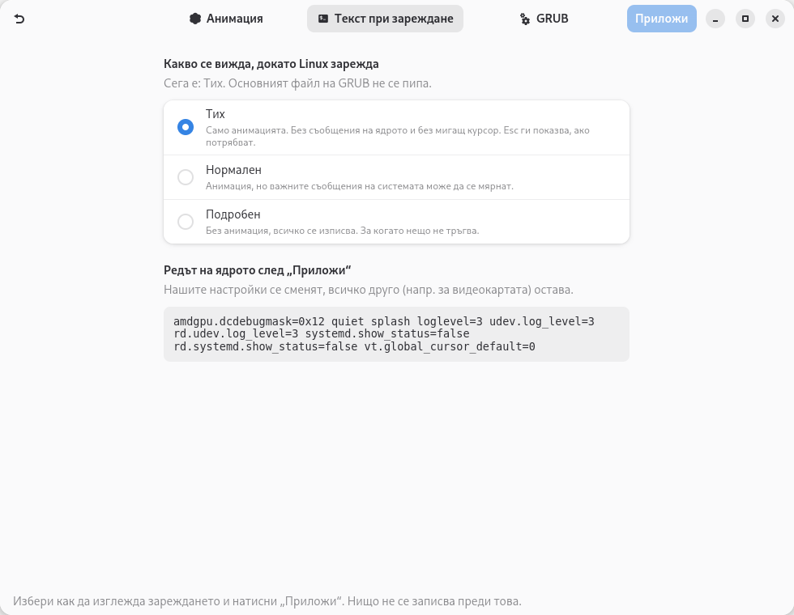

# boot-marka: зареждане на Linux с картинки

Програма за Debian, с която настройваш **как изглежда зареждането на компютъра**, без да пипаш конфигурационни файлове.



## Какво може
- **🎬 Анимация (Plymouth).** Галерия с всички инсталирани теми, с **живи миниатюри**. Има и **„Моя анимация“**: даваш GIF, видео или лого, а програмата прави от него тема. Задаваш цвят на фона (сам се взема от картинката), големина, скорост и надпис.
- **Какво има под анимацията.** Повтарящите се варианти не зависят от това колко бързо зарежда компютърът:
  - **Трикольор:** една лента в бяло, зелено и червено блещука отляво надясно, с искра;
  - **Знаме:** три ивици се пълнят на място, искрят и проблясват;
  - бягаща светлинка, три пулсиращи точки или надпис „Зареждане…“;
  - класическата лента за напредъка или нищо.
- **🤫 Текст при зареждане.** Три режима. Другите настройки на ядрото (например за видеокартата) остават непокътнати.
  - **Тих:** само анимацията, без съобщения на ядрото и без мигащ курсор.
  - **Нормален.**
  - **Подробен:** всичко се изписва, за когато нещо не тръгва.
- **🐧 GRUB.** Скрито меню, обратно броене или меню; колко секунди да чака; да помни ли последния избор; разделителна способност; картинка за фон.
- **↶ Върни както беше.** Маха всичко, направено от програмата, и връща старата анимация.


| Текст при зареждане | GRUB |
|---|---|
|  |  |

## Инсталиране
Свали `.deb` от [Releases](https://github.com/nikogurzov/boot-marka/releases) и:
```
sudo apt install ./boot-marka_0.4.0_all.deb
```
В менюто я търси като **„Зареждане (boot-marka)“**.

## Безопасно
- Нищо не се записва, докато не натиснеш **„Приложи“** и не въведеш паролата (pkexec).
- **Основният `/etc/default/grub` не се пипа.** Настройките са в отделен файл, `/etc/default/grub.d/99-boot-marka.cfg`, който може да се изтрие на ръка.
- При първото прилагане програмата запазва как е било всичко преди нея (`/var/backups/boot-marka`).
- Собствените теми са в `/usr/share/plymouth/themes/boot-marka-*`. Помощникът проверява всеки файл, преди да го сложи: само PNG кадри и скрипт, направен от програмата.
- Ако дискът е криптиран, паролата се пита върху анимацията.
- При NVIDIA програмата предлага поправката `nvidia-drm.modeset=1`, без която анимацията може да не се вижда.

## За разработчици
```
./boot-marka.py            прозорец
./boot-marka.py --text     как е настроено сега (само чете)
./boot-marka.py --reset    връща всичко както беше
./build-deb.sh             прави dist/boot-marka_<версия>_all.deb
python3 -m unittest discover -s tests          тестове в пясъчник (не пипат системата)
python3 tools/pregled.py анимация.gif out.mp4 trikolor     видео преглед без рестартиране
```

## English
boot-marka is a GTK 4 / libadwaita app for Debian. It shows a live gallery of Plymouth boot splash themes and turns your own GIF, video or logo into a theme. It can add a looping indicator under the animation (Bulgarian tricolor shimmer, filling flag, dots, text), choose a quiet, normal or verbose boot, and set GRUB options. Changes go to a separate GRUB drop-in, and everything can be undone with one click.

Лиценз: MIT. От семейството на [drv-marka](https://github.com/nikogurzov/drv-marka).
